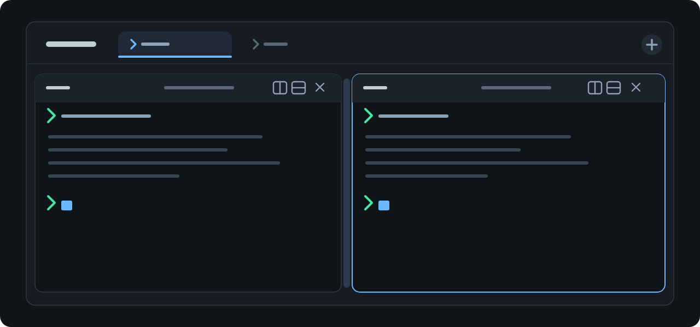

# Terminal workspace for DeepSeek Harness

**A real terminal, docked in the left sidebar of DSH — one iTerm2-shaped window
with tabs, split panes, and draggable gutters.**

English | [中文](README.zh.md)



DeepSeek Harness gives you a terminal in the conversation sidebar, but it is
bound to the conversation you are looking at, and it is one screen. This plugin
adds a second, different thing: a **workspace** you keep open while you work,
shaped like the terminal emulator you already use.

## Why another terminal

- **Global, not per-conversation.** The tab strip and the splits stay exactly as
  they are when you move between conversations. Nothing is recreated, nothing is
  re-bound.
- **Splits you can resize.** Two panes side by side, drag the gutter, the ratio
  is remembered with the layout.
- **Tabs that survive.** Rename a tab, close the one next to it, come back
  tomorrow — the layout is still yours.
- **The last screen comes back.** Restart the app and every pane shows what you
  last saw, with a note that nothing is running.

## Install

```sh
dsh plugin --profile <your-profile> add dsh-terminal-workspace
```

Or install the package directory from **Plugins → Add plugin** in the app.

Then enable the bundle in **Plugins**; a **Terminal** row appears in the left
sidebar. Enable the whole bundle rather than its single row, and restart the app
once so the client bundle is loaded.

Requires DeepSeek Harness **0.2.2-rc.1** or newer (`engines.dsh` is
`>0.2.2-rc.0 <0.3.0-0`) — the terminal service this plugin drives landed there.

## Using it

| What | How |
|---|---|
| Open the workspace | The **Terminal** row in the left sidebar |
| New tab | **+** in the bar |
| Rename a tab | Double-click its title, or `F2` |
| Close a tab | Its **×**, or middle-click — this ends every shell in it |
| Split a pane | The two split buttons in the pane header |
| Resize a split | Drag the gutter between two panes |
| Split from the keyboard | `⌘D` right / `⌘⇧D` down on macOS; `Alt+Shift+D` and `Alt+Shift+E` elsewhere |

`Ctrl+D` is deliberately left to the shell, which is why the non-macOS chords use
`Alt+Shift`.

Keyboard-only use: `Tab` moves between controls, `←`/`→`/`Home`/`End` move along
the tab strip, and a focused tab's **×** is reachable with `Tab`.

## After a restart

A PTY lives in the Harness process, so restarting the app ends every shell. The
plugin keeps each pane's **last screen** in `localStorage` — about 300 lines or
24k characters per pane — and replays it when the panel reopens, with a note
saying no shell is running.

**New terminal** starts a fresh shell. **Clear** discards the saved screen.
Closing a pane or tab deletes its saved screen.

What this restores is the *text you last saw*: output already printed, prompts,
and any commands still on screen. It cannot restore a running process, so a build
or a server that was in the middle of something is gone.

## How it relates to the built-in terminal

The plugin owns **no PTY**. Each pane is an xterm.js screen bound to the installed
`@deepseek-ai/dsh-api-terminal-controller` Client service (`ctx.webTerminals`) —
the same service behind the shipped right-sidebar terminal tabs. That service
owns process lifetime, screen recovery and reconnection, so:

- A shell keeps running while you switch tabs or reload the page.
- Closing a pane or tab ends that shell, exactly like closing a terminal tab.
- Without that service the panel says so and starts no shells.

Because it drives that service rather than a private one, only one Harness window
should type into a given shell at a time; the service serializes input across
windows and marks other attachments read-only with a **Take control** action.

The service allocates a shell under a conversation, so the workspace keeps one
internal *anchor* conversation for its shells. That choice is made once and never
shown: the panel has no Session picker, and changing the conversation on screen
does not touch it.

## Limits

- Layouts and the per-pane last screens live in `localStorage` — one workspace
  per browser profile. Another browser or profile starts empty.
- The restored screen is text only: colours come back as the emulator draws them
  now, not as they were.
- A shell the Host no longer knows is reported, and the pane offers **New
  terminal**.
- The Host's terminal count limit still applies; a pane that hits it says so.
- The terminal service reclaims a shell idle for two hours with no attached
  window. An on-screen pane reattaches long before that, but a workspace left for
  a long time may come back **exited**. The shipped right-sidebar terminal holds
  its own shells against that reclamation, and this plugin deliberately does not
  touch that hold list — two writers would evict each other's.

## Development

xterm.js and its fit addon are vendored under `vendor/` (MIT; see
`vendor/LICENSE.xterm`, `vendor/LICENSE.addon-fit`, and `assets/THIRD-PARTY.md`)
and wrapped into the lazy chunk `client/client.xterm.js`:

```sh
node scripts/build-chunk.mjs
```

The emulator (~490 KiB) is fetched the first time a pane mounts, so the panel
bundle itself stays small. `client/client.js` uses `h()` directly — there is no
JSX build step.

## License

MIT. xterm.js and addon-fit are MIT, © the xterm.js authors.
