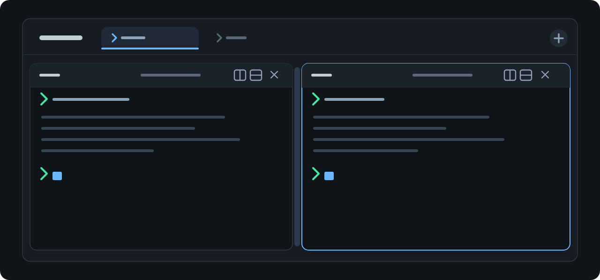

# DeepSeek Harness 终端工作区

**把真正的终端停靠在 DSH 左侧栏——一个 iTerm2 形状的窗口，带标签页、分屏和可拖动的分隔条。**

[English](README.md) | 中文



DeepSeek Harness 在会话侧栏里自带一个终端，但它跟着当前会话走，而且只有一个屏幕。这个插件加的是另一件东西：一个你干活时一直开着的**工作区**，形状就是你惯用的那个终端模拟器。

## 为什么还要一个终端

- **全局的，不按会话分。** 切换会话时标签页和分屏原样不动——不会被重建，也不会被重新绑定。
- **分屏能调比例。** 左右两块，拖动分隔条即可，比例随布局一起记住。
- **标签页是留得住的。** 重命名、关掉旁边那个、第二天再回来，布局还是你的。
- **最后一次的屏幕会回来。** 重启客户端后，每个分屏显示你最后看到的内容，并注明当前没有 shell 在运行。

## 安装

```sh
dsh plugin --profile <你的 profile> add dsh-terminal-workspace
```

或者在应用里用 **插件 → 添加插件** 安装本地目录。

然后在**插件**里启用这个 bundle，左侧栏就会出现**终端**一行。请启用整个 bundle 而不是它下面的单行，并重启一次客户端，让浏览器端代码加载。

要求 DeepSeek Harness **0.2.2-rc.1** 及以上（`engines.dsh` 为 `>0.2.2-rc.0 <0.3.0-0`）——它驱动的终端服务是从这个版本开始提供的。

## 怎么用

| 想做什么 | 怎么做 |
|---|---|
| 打开工作区 | 左侧栏的**终端** |
| 新建标签页 | 顶栏的 **+** |
| 重命名标签页 | 双击标题，或按 `F2` |
| 关闭标签页 | 它的 **×**，或中键点击——这会结束其中所有 shell |
| 拆分当前分屏 | 分屏标题栏里的两个分屏按钮 |
| 调整分屏比例 | 拖动两个分屏之间的分隔条 |
| 用键盘分屏 | macOS：`⌘D` 向右、`⌘⇧D` 向下；其它平台：`Alt+Shift+D`、`Alt+Shift+E` |

`Ctrl+D` 特意留给 shell 自己，所以非 macOS 用 `Alt+Shift`。

纯键盘操作：`Tab` 在控件间移动，`←`/`→`/`Home`/`End` 在标签页之间移动，聚焦标签页后按 `Tab` 可以到达它的 **×**。

## 重启之后

PTY 活在 Harness 进程里，所以重启应用会结束所有 shell。插件把每个分屏的**最后一次屏幕内容**存在 `localStorage` 里——每个分屏约 300 行或 24000 字符——重新打开面板时回放，并注明当前没有 shell 在运行。

**新建终端**会开一个新的 shell；**清除**丢弃这段内容。关闭分屏或标签页会一并删除它保存的屏幕内容。

恢复的是*你最后看到的文字*：已经打印的输出、提示符、还留在屏幕上的命令。它不能恢复运行中的进程，所以一个跑到一半的构建或服务是真的没了。

## 和内置终端的关系

这个插件**不持有任何 PTY**。每个分屏是一块 xterm.js 屏幕，绑定在已安装的 `@deepseek-ai/dsh-api-terminal-controller` 客户端服务（`ctx.webTerminals`）上——就是内置右侧栏终端页签用的那个服务。进程生命周期、屏幕恢复和重连都由它负责，因此：

- 切换标签页或刷新页面时 shell 继续运行。
- 关闭分屏或标签页会结束对应的 shell，和关掉终端页签一样。
- 没有那个服务时，面板会明说，并且不启动任何 shell。

因为驱动的是那个服务而不是私有实现，同一个 shell 同一时刻应当只有一个 Harness 窗口在输入；服务会在窗口之间串行化输入，并把其它连接标记为只读，附带一个**接管**操作。

服务按会话分配 shell，所以工作区给自己的 shell 保留了一个内部**锚定**会话。这个选择只做一次、永不显示：面板没有会话选择器，切换屏幕上的会话也不会动它。

## 限制

- 布局和每个分屏的屏幕内容存在 `localStorage` 里——一个浏览器配置一份工作区。换浏览器或换配置就是空的。
- 恢复的屏幕只有文字：颜色按模拟器现在的方式绘制，而不是当时的样子。
- 宿主已经不认识的 shell 会被报出来，分屏会提供**新建终端**。
- 宿主的终端数量上限依然生效；撞到上限的分屏会说明原因。
- 终端服务会回收闲置两小时、没有窗口挂着的 shell。屏幕上的分屏远早于此就会重新挂上，但你长时间丢着不管的工作区回来时可能已经是**已退出**状态。内置右侧栏终端会为自己持有的 shell 挡住这个回收，本插件刻意不碰那份名单——两个写入方会互相把对方的 hold 挤掉。

## 开发

xterm.js 和它的 fit addon 以 MIT 许可内置在 `vendor/`（见 `vendor/LICENSE.xterm`、`vendor/LICENSE.addon-fit` 和 `assets/THIRD-PARTY.md`），并被包成按需加载的 chunk `client/client.xterm.js`：

```sh
node scripts/build-chunk.mjs
```

模拟器（约 490 KiB）在第一个分屏挂载时才加载，所以面板本身体积很小。`client/client.js` 直接用 `h()`，没有 JSX 构建步骤。

## 许可

MIT。xterm.js 与 addon-fit 同为 MIT，版权归 xterm.js 作者所有。
